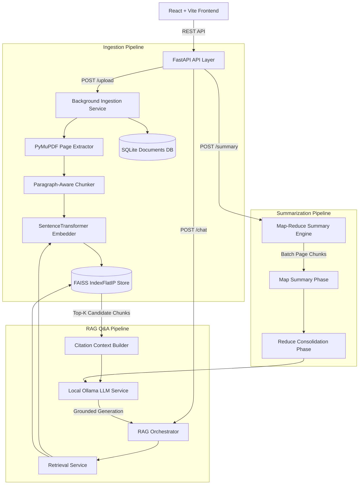

# Technical Architecture — AI PDF Summarizer & RAG Q&A

## Overview

The application is structured into a decoupled **React + Vite Frontend** and a **FastAPI Backend**, using local embedding models (`BAAI/bge-small-en-v1.5`), a persistent **FAISS** vector store, **SQLite** document registry, and a local **Ollama** LLM instance (`llama3.2`).

## Data Persistence & Consistency

1. **SQLite Database (`backend/data/documents.db`)**: Stores document metadata, SHA256 hashes for deduplication, extraction statistics, and background processing statuses.
2. **FAISS Index (`backend/data/vectorstore/faiss.index`)**: Stores L2-normalized float32 vectors indexed via Inner Product (Cosine similarity).
3. **FAISS Metadata (`backend/data/vectorstore/metadata.json`)**: Parallel side-car file storing chunk text and source page citations mapped 1:1 with FAISS vector positions.
4. **Document Deletion Rebuild**: When a document is deleted, all associated chunk vectors are removed and the FAISS index is re-indexed from remaining chunks, ensuring zero orphan vectors.

## Grounded Q&A & Citation Strategy

- Source citations are derived **exclusively** from FAISS retrieval metadata (`filename`, `page_number`, `score`, `snippet`).
- The LLM is supplied with explicit context blocks containing source labels (`[1] Source: manual.pdf - Page 42`).
- If context relevance is low or missing, the system returns a grounded refusal string without inventing facts.
